# Krista Managed Queue Extension - Architecture Document

**Version**: 3.2.4  
**Last Updated**: January 2026

---

## Table of Contents

1. [High-Level Architecture](#1-high-level-architecture)
2. [Layer Breakdown](#2-layer-breakdown)
3. [Component Interaction](#3-component-interaction)
4. [Data Flow](#4-data-flow)
5. [Storage Architecture](#5-storage-architecture)
6. [Caching Strategy](#6-caching-strategy)
7. [Performance Limitations](#7-performance-limitations)
8. [Error Scenarios](#8-error-scenarios)
9. [Thread Safety & Synchronization](#9-thread-safety--synchronization)

---

## 1. High-Level Architecture

The Krista Managed Queue extension follows a **5-layer architecture** pattern that separates concerns and enables maintainability, testability, and scalability.

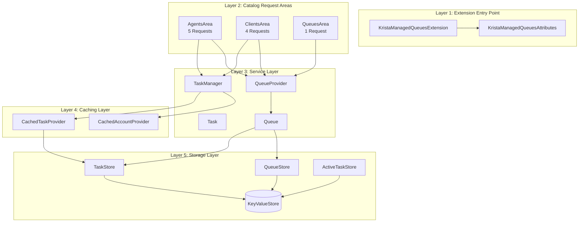

---

## 2. Layer Breakdown

### Layer 1: Extension Entry Point

| Component | Class | Responsibility |
|-----------|-------|----------------|
| Extension | `KristaManagedQueuesExtension` | Entry point, configuration, validation |
| Attributes | `KristaManagedQueuesAttributes` | Role loading, configuration caching |

**Key Annotations:**
- `@Extension` - Marks class as Krista extension
- `@Java(JAVA_21)` - Java version requirement
- `@Field` - Configuration field definition
- `@StaticResource` - Static resource serving

### Layer 2: Catalog Request Areas

| Area | Class | Requests | Purpose |
|------|-------|----------|---------|
| Agents | `AgentsArea` | 5 | Agent operations (Join, Leave, Get Tasks) |
| Clients | `ClientsArea` | 4 | Client operations (Submit, Routing) |
| Queues | `QueuesArea` | 1 | Queue listing |

### Layer 3: Service Layer

| Interface | Implementation | Purpose |
|-----------|----------------|---------|
| `TaskManager` | `TaskManagerImpl` | Task CRUD, lifecycle management |
| `QueueProvider` | `QueueProviderImpl` | Queue lookup, role-to-queue mapping |
| `Task` | `TaskImpl` | Task entity with join/leave operations |
| `Queue` | `QueueImpl` | Queue entity with task submission |

### Layer 4: Caching Layer

| Class | Cache Type | Scope | Purpose |
|-------|------------|-------|---------|
| `CachedTaskProvider` | `ConcurrentHashMap<String, Task>` | Application | Thread-safe task caching |
| `CachedAccountProvider` | `ThreadLocal<Map<String, Account>>` | Request | Request-scoped account caching |

### Layer 5: Storage Layer

| Class | Key Pattern | Data Type | Purpose |
|-------|-------------|-----------|---------|
| `TaskStore` | `task:{taskId}` | `TaskDto` (JSON) | Task persistence |
| `QueueStore` | `queue:{queueId}` | `List<String>` (JSON) | Queue-to-task mapping |
| `ActiveTaskStore` | `participant:{accountId}` | `List<String>` (JSON) | Agent active tasks |

---

## 3. Component Interaction

### Dependency Injection Graph

```mermaid
graph LR
    subgraph "HK2 Dependency Injection"
        QPI[QueueProviderImpl]
        TMI[TaskManagerImpl]
        TI[TaskImpl]
        QI[QueueImpl]
        CTP[CachedTaskProvider]
        CAP[CachedAccountProvider]
        TS[TaskStore]
        QS[QueueStore]
        ATS[ActiveTaskStore]
        JM[JsonMapper]
        KVS[KeyValueStore]
        NM[NotificationManager]
        IM[InboxManager]
        RC[RuntimeContext]
    end
    
    QPI -->|@Inject| QS
    QPI -->|@Inject| TMI
    QPI -->|@Inject| TS
    QPI -->|@Inject| NM
    QPI -->|@Inject| RC
    
    TMI -->|@Inject| CTP
    TMI -->|@Inject| CAP
    TMI -->|@Inject| TS
    TMI -->|@Inject| ATS
    
    TI -->|@Inject| TS
    TI -->|@Inject| QS
    TI -->|@Inject| ATS
    TI -->|@Inject| NM
    TI -->|@Inject| IM
    
    TS -->|@Inject| KVS
    TS -->|@Inject| JM
    QS -->|@Inject| KVS
    QS -->|@Inject| JM
    ATS -->|@Inject| KVS
    ATS -->|@Inject| JM
```

---

## 4. Data Flow

### 4.1 Task Submission Flow (Client → Queue)

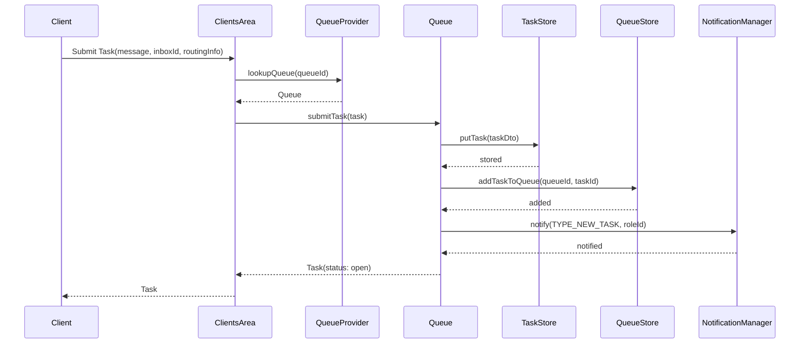

### 4.2 Agent Join Flow

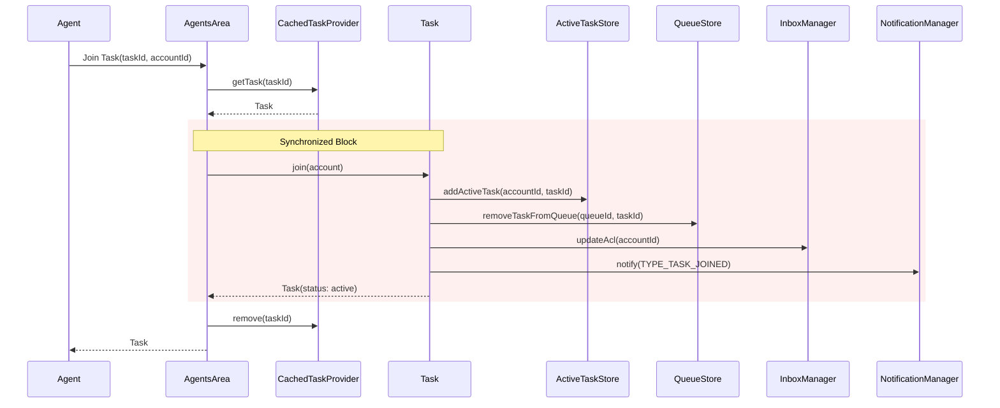

### 4.3 Agent Leave Flow

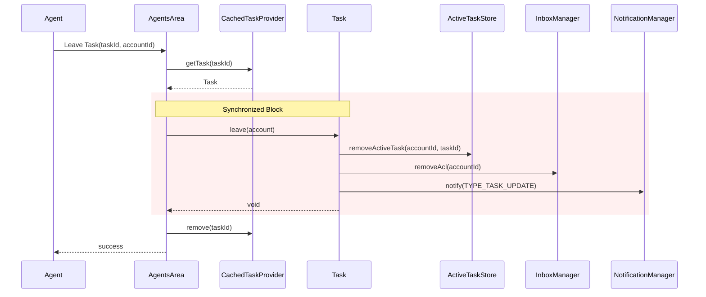

---

## 5. Storage Architecture

### 5.1 Key-Value Store Schema

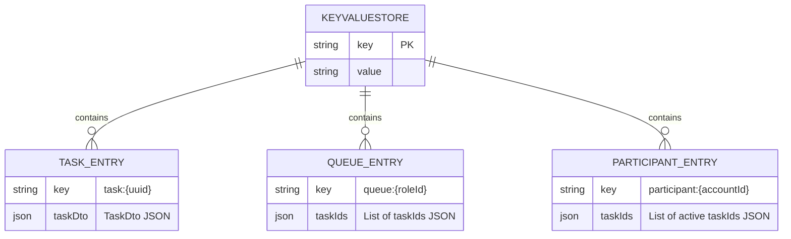

### 5.2 Data Serialization

| Store | Key Format | Value Format | Serializer |
|-------|------------|--------------|------------|
| TaskStore | `task:{taskId}` | JSON string | `JsonMapper.toJson(TaskDto)` |
| QueueStore | `queue:{queueId}` | JSON array | `JsonMapper.toJson(List<String>)` |
| ActiveTaskStore | `participant:{accountId}` | JSON array | `JsonMapper.toJson(List<String>)` |

### 5.3 TaskDto Structure

```java
class TaskDto {
    String taskId;           // UUID
    String sessionId;        // Inbox ID
    String message;          // Support request message
    long creationTime;       // Epoch milliseconds
    AccountDto creator;      // Task creator
    Map<String, Set<AccountDto>> activeParticipants;  // queueId → agents
}

class AccountDto {
    String accountId;
    String accountName;
    
    static AccountDto IN_QUEUE;  // Placeholder for waiting task
}
```

---

## 6. Caching Strategy

### 6.1 Cache Architecture

```mermaid
graph TB
    subgraph "Request Scope"
        REQ[Incoming Request]
        CAP[CachedAccountProvider<br/>ThreadLocal&lt;Map&gt;]
    end
    
    subgraph "Application Scope"
        CTP[CachedTaskProvider<br/>ConcurrentHashMap]
    end
    
    subgraph "Persistent Storage"
        KVS[(KeyValueStore)]
    end
    
    REQ --> CAP
    REQ --> CTP
    
    CAP -->|Cache Miss| KVS
    CTP -->|Cache Miss| KVS
    
    CAP -.->|clear() after request| CAP
    CTP -.->|remove() after join/leave| CTP
```

### 6.2 Cache Behavior

| Cache | Type | Thread Safety | Invalidation |
|-------|------|---------------|--------------|
| `CachedTaskProvider` | `ConcurrentHashMap<String, Task>` | Built-in | Explicit removal after join/leave |
| `CachedAccountProvider` | `ThreadLocal<Map<String, Account>>` | Thread-isolated | `clear()` after each request |

### 6.3 Cache Lifecycle

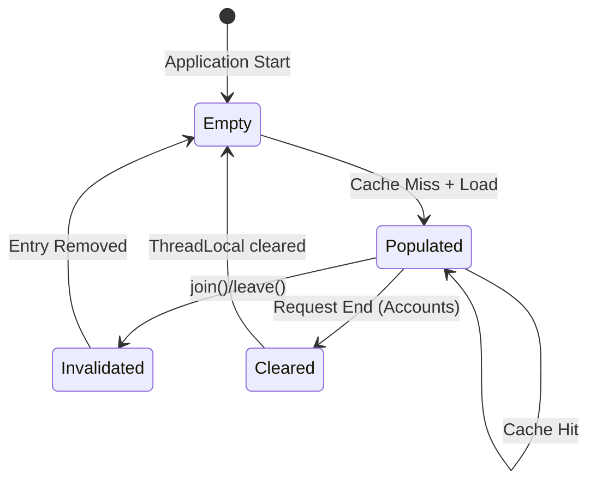

---

## 7. Performance Limitations

### 7.1 Known Limitations

| Area | Limitation | Impact | Mitigation |
|------|------------|--------|------------|
| **Queue Iteration** | `getAllQueues()` iterates all roles | O(n) per lookup | Use specific queue ID when known |
| **Task Search** | No indexed search | Full scan for open tasks | Use pagination, cache results |
| **Synchronization** | Task-level locks | Blocking during join/leave | Brief locks, minimal contention |
| **Storage I/O** | JSON serialization per operation | Latency on large DTOs | Keep task data minimal |
| **Notification Overhead** | 2 notifications per join/leave | Network I/O | Batch if possible |

### 7.2 Scalability Constraints

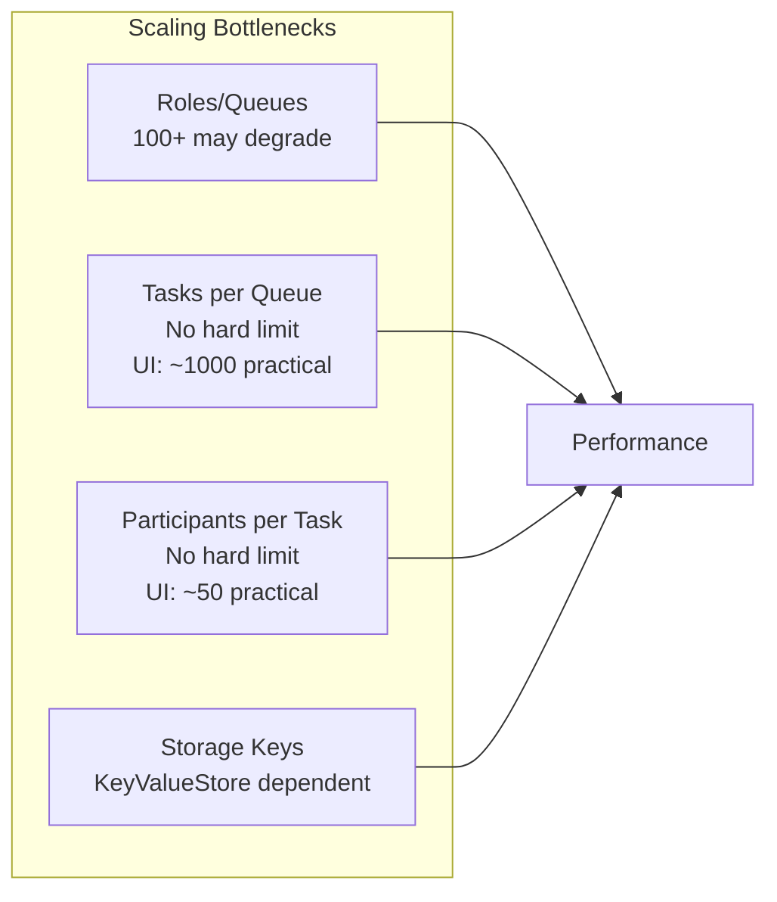

### 7.3 Performance Recommendations

| Scenario | Recommendation |
|----------|----------------|
| High task volume | Use pagination with `offset` and `limit` (10-50 items) |
| Many queues | Cache queue lookups at client level |
| Concurrent agents | Task-level synchronization handles this |
| Large messages | Keep task messages under 64KB |

---

## 8. Error Scenarios

### 8.1 Error Flow Diagram

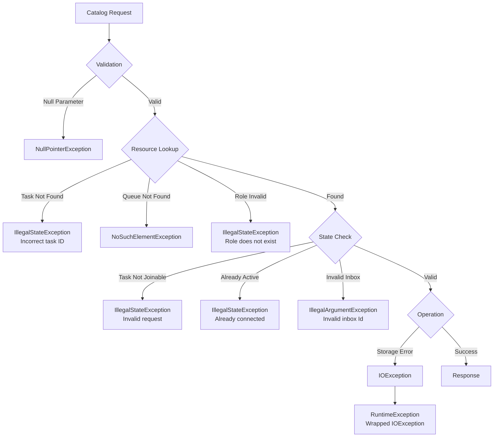

### 8.2 Error Catalog

| Error Type | Scenario | HTTP Equivalent | Recovery |
|------------|----------|-----------------|----------|
| `NullPointerException` | Required parameter null | 400 Bad Request | Provide all required params |
| `IllegalStateException` | Task not found | 404 Not Found | Verify task exists first |
| `IllegalStateException` | Invalid request state | 409 Conflict | Check task state before operation |
| `IllegalStateException` | Already connected | 409 Conflict | Complete existing task first |
| `IllegalArgumentException` | Invalid inbox format | 400 Bad Request | Use Get Inbox Id request |
| `NoSuchElementException` | Queue not found | 404 Not Found | Verify queue configuration |
| `IOException` | Storage/network failure | 500 Internal Error | Retry operation |

### 8.3 Error Handling Pattern

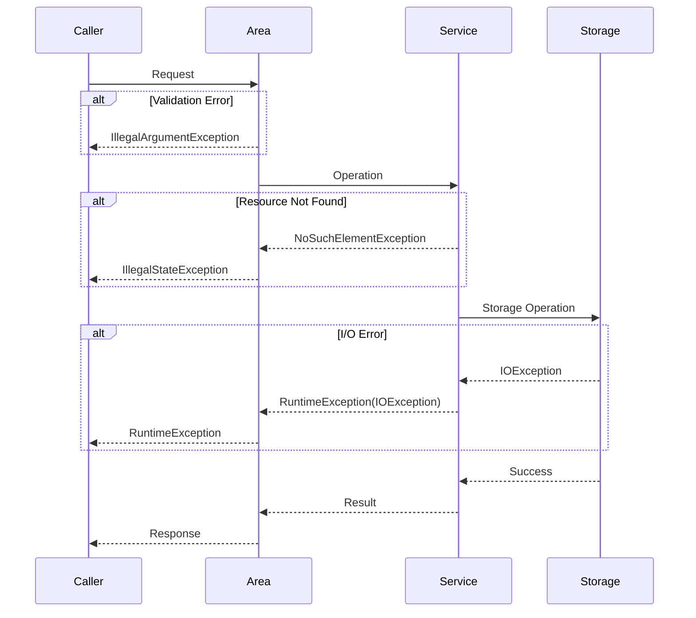

---

## 9. Thread Safety & Synchronization

### 9.1 Synchronization Points

```mermaid
graph TB
    subgraph "Thread-Safe Components"
        CTP[CachedTaskProvider<br/>ConcurrentHashMap]
        CAP[CachedAccountProvider<br/>ThreadLocal + synchronized]
    end
    
    subgraph "Synchronized Operations"
        JOIN[join&#40;&#41;<br/>synchronized&#40;task&#41;]
        LEAVE[leave&#40;&#41;<br/>synchronized&#40;task&#41;]
    end
    
    subgraph "Non-Synchronized"
        READ[Read Operations<br/>Get Tasks, Get Task]
        SUBMIT[Submit Task<br/>New task creation]
    end
    
    T1[Thread 1] --> CTP
    T2[Thread 2] --> CTP
    T1 --> JOIN
    T2 --> JOIN
    
    JOIN -.->|Blocks| JOIN
```

### 9.2 Concurrency Model

| Component | Thread Safety Mechanism | Notes |
|-----------|------------------------|-------|
| `CachedTaskProvider` | `ConcurrentHashMap` | Lock-free reads, atomic updates |
| `CachedAccountProvider` | `ThreadLocal` + `synchronized` | Thread isolation + sync for lookup |
| `TaskImpl.join()` | `synchronized(this)` | Task-level lock |
| `TaskImpl.leave()` | `synchronized(this)` | Task-level lock |
| `QueueStore` | None (relies on KeyValueStore) | Single-writer assumption |

### 9.3 Race Condition Prevention

```java
// In AgentsArea.joinTask()
synchronized (task) {
    task.join(account);
}
cachedTaskProvider.remove(taskId);
cachedAccountProvider.clear();
```

This pattern ensures:
1. Only one thread modifies task at a time
2. Cache is invalidated after modification
3. Subsequent requests see fresh data

---

## Appendix A: Class Diagram

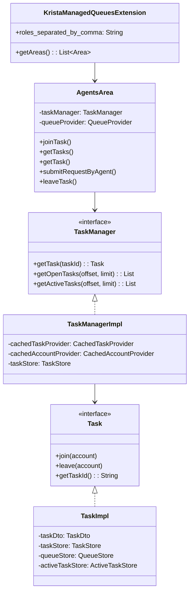

---

*Architecture Document - Krista Managed Queue Extension v3.2.4*

